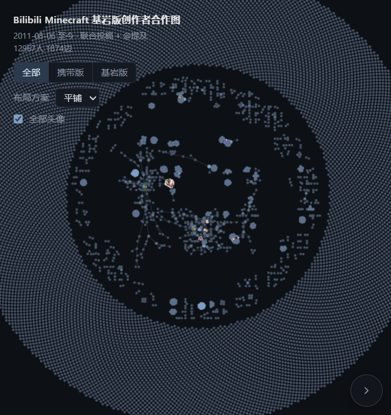
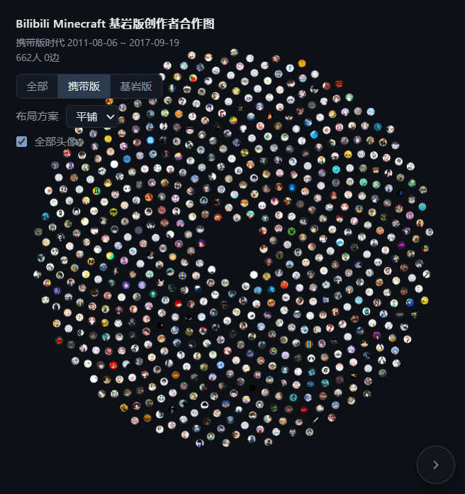

# Bilibili Minecraft 基岩版创作者

B 站基岩版（含携带版时代）创作者的完整合作网络图。Canvas 单页应用，支持时代切换、四种布局、头像、搜索与「连接两位创作者」。

- 在线站点：https://bedrock-creators-w9ox4sxok25.qoder.zone/
- 本地预览：`python server.py` → http://127.0.0.1:8765/

## 数据规模

| 指标 | 数值 |
| --- | --- |
| 扫描视频（标题/简介/标签） | 134,487 |
| 基岩相关视频（详情已抓） | 121,280 |
| 图中创作者 | 17,418 |
| 合作边 | 5,668（联合投稿 + @提及） |
| 携带版时代（2011-08-06 ~ 2017-09-19） | 683 人 |
| 基岩版时代（2017-09-20 至今） | 16,938 人 |

## 数据口径

- **来源**：B 站公开 Web API（未登录），三轮回溯召回
  1. 11 个关键词 × 年份切片搜索（绕过单查询 1000 条上限）
  2. 按创作者名字枚举其投稿（每人最多 5 页/150 条）
  3. MCBE 关键词按月切片（185 个月）
- **入图门槛**：视频标题/简介/标签命中基岩信号（基岩、bedrock、MCBE、MCPE、携带版、addon、行为包、PE、手机版+MC 语境 等）
- **合作边**：联合投稿（staff 全员两两互连）+ 简介/标题中可解析的 @提及（需匹配到图内创作者）
- **时代划分**：视频发布时间早于 2017-09-20 归「携带版」，否则归「基岩版」

### 已知上限

- 搜索单查询最多 ~1000 条；超大 UP 每人仅枚举最新 150 条
- 私密、已删除、仅粉丝可见的视频无法获取
- 「网易版」未单独纳入（用户决定）；单独「BE」不作信号（歧义过大）
- 携带版时代 0 条边是真实结果：B 站联合投稿 2019 年才上线，且该时代可解析 @ 均为自己 @ 自己

## 目录结构

```
index.html        # 单页前端（Canvas 渲染、交互、头像懒加载）
data.js           # window.GRAPH = { nodes, links }（构建产物，前端直接加载）
layouts/          # 12 个预计算布局（3 视图 × flat/comm/hierarchy/hub）
server.py         # 本地预览服务（no-cache，端口 8765）
build_graph.py    # 由抓取状态构建节点/边，输出 graph.json + data.js
layout.py         # 纯 Python 布局计算（力导向/社区/径向树/枢纽，含碰撞松弛）
crawl.py          # 爬虫：search / space / mcbe / details 四个阶段，可断点续跑
启动预览.cmd       # Windows 一键启动本地预览
```

`state/` 含完整抓取原始数据（约 150MB），随仓库提供，可离线重建而无需重新抓取；`dist/` 为发布产物，不纳入版本库。

## 预览图

| 总览 | 核心区头像 |
| --- | --- |
|  |  |

| 携带版时代 | 基岩版放大 |
| --- | --- |
|  |  |

## 本地运行

```bash
# 仅预览（无需抓取）
python server.py            # Python 3.8+，打开 http://127.0.0.1:8765/
```

## 重建数据（可选，需数小时并遵守 B 站频率限制）

```bash
python crawl.py search      # 关键词 × 年份切片
python crawl.py details     # 视频详情（联合投稿 staff / 完整简介 / 头像）
python crawl.py space       # 按创作者名字枚举投稿
python crawl.py mcbe        # MCBE 月度切片补量
python build_graph.py       # 生成 graph.json / data.js
python layout.py            # 生成 layouts/*.json（内含 hash 校验）
```

抓取状态全部落在 `state/`，中断后可继续；遇到 412 会自动全局刹车并换 buvid。请保持礼貌频率，勿多实例并行。

## 前端行为

- 时代切换：全部 / 携带版 / 基岩版（节点、边、统计、布局同步过滤）
- 布局：平铺 / 层级（径向树）/ 枢纽（中心放射）/ 社区（向日葵打包 + 分组着色）
- 布局文件带 `count + hash` 校验，不匹配会拒绝加载
- 头像：懒加载；B 站头像 CDN 防盗链，必须空 Referer（`referrerPolicy=no-referrer`）
- 隐私与性能：全头像模式限制屏幕半径 ≥2.5px，头像缓存 LRU 3000 条

## 部署

当前线上使用 Qoder Sites（静态托管，`dist/` 目录）。也可用 GitHub Pages：

1. 仓库根目录已包含 `index.html / data.js / layouts/`，可直接作为 Pages 源
2. Settings → Pages → Source: `Deploy from a branch` → `main` / `(root)`
3. 访问 `https://<用户名>.github.io/<仓库名>/`

## 上传到 GitHub

用仓库文件夹 `github-upload/`（已包含全部代码、数据与素材）。先在 GitHub 网页端新建一个**空仓库**（不要勾选 README），然后：

```bash
cd "D:/新建文件夹 (5)/github-upload"
git init
git add -A
git commit -m "feat: Bilibili Bedrock creator collaboration graph"
git branch -M main
git remote add origin https://github.com/<你的用户名>/<仓库名>.git
git push -u origin main
```

如果使用 SSH：`git remote add origin git@github.com:<用户名>/<仓库名>.git`。

注意事项：
- 仓库约 155MB，`state/` 里最大的单文件约 57MB，低于 GitHub 100MB 单文件限制；首次推送较慢属正常
- `buvid.json`（cookie 指纹）与 `crawl.log` 已排除
- `dist/` 为发布产物，可忽略；GitHub Pages 直接使用仓库根目录
- HTTPS 方式推送时，密码位置填 Personal Access Token

## 免责声明

数据来自 B 站公开接口，头像与视频信息版权归原 UP 主所有，本项目仅用于社区研究与可视化展示。请勿用于商业用途或高频抓取。
